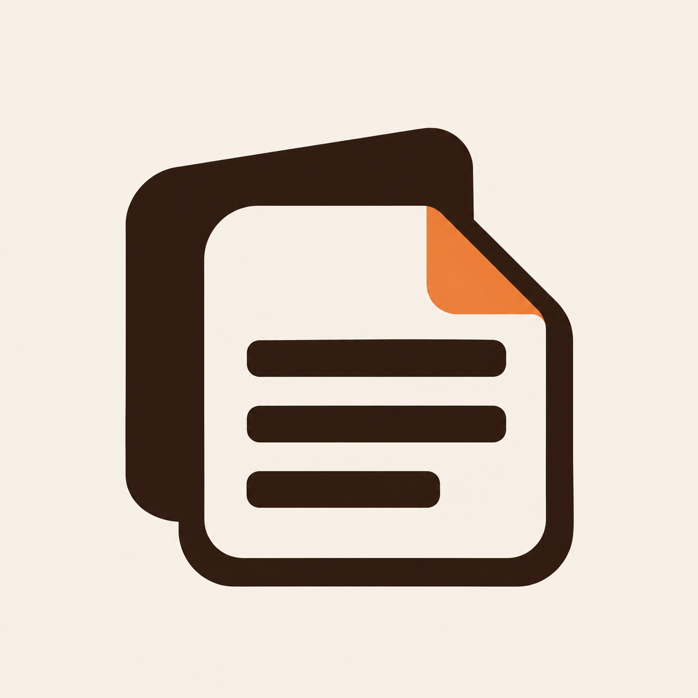

# OSM Content

Turn real work, ideas and references into content worth sharing. Keep the
author's voice, choose a purpose for each edition and learn from the response.

OSM Content is a separate method and adaptable starter kit for
[The Onlinesourdough Method](https://github.com/onlinesourdough/OSM-plugin).
It uses the business foundation in the owner's AI operating model home.
Existing editors, human workflows and useful personal skills can stay.

## Start here

For one post, use the [short-post workflow](docs/post-workflow.md).
For initial setup, give your agent this repository and your private context-home
link. Ask it to read [setup](docs/setup.md) and
[configuration](docs/configuration.md), inspect what exists and adapt only what
is missing. Your own home supplies the routes and permissions.

The [Notion guide](https://gustavanderson.notion.site/40d6d2e17f5681219a81e13317a19339)
is the readable companion. [Releases](https://github.com/onlinesourdough/OSM-Content/releases)
identify the shared source. Actual goals, channels, voice, media and adapted
personal skills stay in the owner's private home.

## A small working loop

1. Save the idea or reference and why it matters.
2. Choose the reader, purpose and your own contribution.
3. Write, record or edit only the editions that help.
4. Review and deliver under the owner's selected publication authority.
5. Keep the result and one useful lesson for the next piece.

A short post can stand alone. Different channels can serve different goals.
An informative or reflective post can end with its point; a sales invitation
or external link is a choice, not a requirement.

## The foundation

Use one existing Content collection for three responsibilities:

| Record | Keeps |
| --- | --- |
| Source | Original attribution, why saved and observed details |
| Content | The author's idea or production, evidence and next action |
| Edition | An independently edited version, review and delivery result |

Knowledge owns goals, audience, offers and voice. Personal Skills carry the
chosen workflow. Media and editor projects use mapped storage; a link is not
a backup. [Creative references](docs/reference-library.md) can improve an
angle, explanation or treatment without becoming an imitation of the creator.

## Adapt the useful templates

Five responsibilities can be covered by existing personal methods. They do
not require five agents or five new skills.

| Responsibility | Starting template |
| --- | --- |
| Setup | [content-setup](templates/content-setup/SKILL.md) |
| Intake | [content-intake](templates/content-intake/SKILL.md) |
| Prepare | [content-prepare](templates/content-prepare/SKILL.md) |
| Produce / Distribute | [content-produce](templates/content-produce/SKILL.md) |
| Learn | [content-learn](templates/content-learn/SKILL.md) |

## Versions and upkeep

The method release is **v0.11.0**. The five retained **v0.10.0 Draft templates**
are unchanged imports from edition 2026-11-05.1, with hashes in
[provenance.json](provenance.json). Their template versions do not become
v0.11.0 merely because the guide has changed. Adapt them with the current
configuration, short-post and reference guidance.

This release distributes method source, not an installable Content plugin.
It activates no account, editor, schedule or publisher. Content has its own
release lifecycle outside the OSM plugin; the archived Agentic-Content-System
remains historical.

[Documentation upkeep](docs/maintenance.md) explains the source-to-guide mapping
and verification. Run `python3 scripts/check_release.py` before release.

MIT licensed. See [LICENSE](LICENSE).
