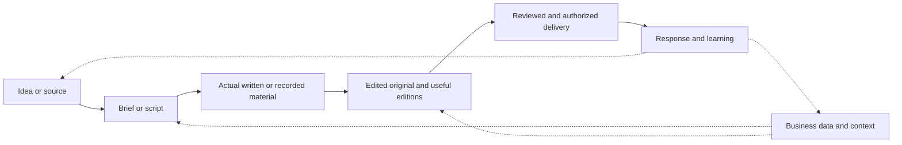

# OSM Content

An optional content method for The Onlinesourdough Method: turn real work,
ideas and sources into useful material, relevant editions and learning.

For solo founders and small teams. Keep your own voice, judgement and creative
process. Use the parts that help, whether your work is analog, manual,
AI-assisted or selectively automated.

**This is a method and adaptable starter kit, outside the OSM plugin.** It is
not a SaaS, a mandatory pipeline, or a plugin that installs five universal skills.

## How it fits

| Part | Responsibility | Home |
| --- | --- | --- |
| OSM | Establish and maintain the business's data and context foundation in Notion | [OSM source and distribution](https://github.com/onlinesourdough/OSM-plugin) |
| OSM Content | Adapt that foundation for content work, with a Content collection and chosen workflow | This repository |
| Your setup | Actual goals, audience, voice, channels, tools, personal skills and permissions | Your private Data & Context home |
| Human guide | Readable overview, navigation and reference library | [Onlinesourdough Method](https://gustavanderson.notion.site/40d6d2e17f568124af82ceb93dabf77a) → [Content extension](https://gustavanderson.notion.site/40d6d2e17f5681219a81e13317a19339) |

Data and context are the foundation. Skills are part of context. OSM core does
not create a Content collection; this optional method creates or reuses it.
OSM upkeep can maintain a selected existing Content collection without this
extension being installed.

The published OSM package may still contain earlier Content helpers while its
accepted separation is delivered through [OSM #88](https://github.com/onlinesourdough/OSM-plugin/issues/88).
Creating this repository does not change an installed or released OSM package.

## Start with your agent

Give your agent this repository and your own private Data & Context entry.
Ask it to read the [setup contract](docs/setup.md) and
[configuration guide](docs/configuration.md), inspect your existing workflow,
reuse suitable stores and methods, and resolve only choices that affect the work.
Your private entry supplies routes and authority; this public repository does not.

Adapt useful templates into your own Skills through the supported skill-management
route. Keep actual business choices in one concise private configuration. Do not
install this repository wholesale or repeat setup for each content idea.

## Five responsibilities

| Responsibility | Result | Adaptable template |
| --- | --- | --- |
| Setup | Content collection, field map, workflow choices and real tool routes | [content-setup](templates/content-setup/SKILL.md) |
| Intake | An idea or source, why it matters and useful angles | [content-intake](templates/content-intake/SKILL.md) |
| Prepare | Brief, draft, manuscript or recording plan; support creating actual material | [content-prepare](templates/content-prepare/SKILL.md) |
| Produce / Distribute | Finished original, useful editions, review and authorized delivery | [content-produce](templates/content-produce/SKILL.md) |
| Learn | Goal-relevant response, effort and a useful next experiment | [content-learn](templates/content-learn/SKILL.md) |

Enter at the point where help is needed. A short idea need not become long form
first. A newsletter can be an original or a synthesis. Comments and conversations
can contribute ideas as well as distribution. An existing human editor or analog
workflow can stay.

## What belongs where

- Knowledge owns goals, audience, offers, voice and working preferences.
- Content owns sources, ideas/productions, independently edited editions and response.
- Personal Skills carry the tailored workflow and reference the actual configuration.
- Media and editor projects use selected storage; a Notion link is not a backup.
- Subscriber systems own subscriptions and unsubscribes.

Notion editorial work and Kit distribution are a starter recipe. Video tools are
chosen and qualified for the actual environment. No editor, account, subscription
or automated publishing service is installed by these documents.

## Status and development

The initial import preserves the five existing **Draft templates v0.10.0** from
public template edition **2026-11-05.1**, with packet/file hashes in
[provenance.json](provenance.json). Their contents are unchanged. This is a source
home, not a new release, proof of native installation or proof of production fit.

Git owns future shared method and template changes. Notion is a readable projection
of a stated source revision; personal adaptations remain with their owners.
See [documentation upkeep](docs/maintenance.md). Do not describe a projection as
current until the affected pages, downloads and source marker have been verified.

Writing-voice calibration is tracked separately in the repository issues. It needs
actual owner examples and correction feedback, not a generic polished writing style.

MIT licensed. See [LICENSE](LICENSE). The archived Agentic-Content-System is
historical and is not revived by this repository.
